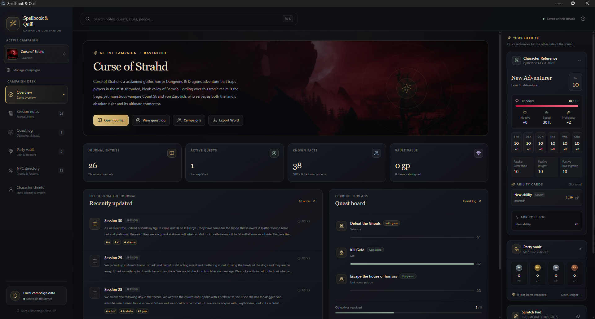

# Spellbook & Quill

A local-first Dungeons & Dragons campaign companion for Windows, macOS, and Linux desktops. Built with Electron, React, TypeScript, Tailwind CSS, Tiptap, and SQLite (`sql.js` WebAssembly). Campaign records live on the local computer; there is no account, cloud sync, analytics, or required online service. The campaign manager is the hub for separate adventures, each with its own journal, quests, NPCs, party vault, scratch pad, and character sheets.

> **A note on how this project is made:** Spellbook & Quill is almost entirely *vibe-coded*. Most of the implementation has been produced and iterated with AI coding assistance from natural-language requirements and feedback, rather than being traditionally hand-written line by line. It is an evolving community/personal project, not audited commercial software. It has not had comprehensive professional security, accessibility, or cross-platform QA. Expect rough edges, keep independent backups, and review/test the code before relying on it for important campaign records.

## Features

- **Session journal:** rich-text notes, headings, lists, bold/italic/underline/strike/code, links, undo/redo, browser/Electron spell-check, styled read-aloud callouts, autosave, dedicated tags, and inline `#tag` suggestions.
- **Multi-campaign manager:** create, switch, edit, and delete campaigns; add optional artwork; restore portable backups; reopen the last-used campaign on startup. Deletion creates a local backup first. There is no archiving or online account feature.
- **Global search:** searches note content, quest names/rewards/objectives/notes, the scratch pad, NPC profiles, NPC encounter logs, loot, and tag names. It searches the active campaign by default, with an option to search all campaigns. Cross-campaign results identify their campaign, and tags can be edited directly on search-result cards.
- **Word campaign archive:** export the active campaign to a formatted `.docx` document through a native Save As dialog. It includes the journal, quests/objectives, NPC profiles and conversation ledger, currency and loot, character sheets and abilities, scratch pad, tags, and roll history. Campaign/NPC artwork is embedded where the image format is supported. This is a readable/offboarding archive, not a restorable app backup.
- **Quest board:** giver/faction, status, rewards, notes, main and side objectives, objective completion, editing, and deletion.
- **Party vault:** PP/GP/SP/CP ledger, GP-equivalent value, item quantity/value, item type, description, tags, and removal.
- **NPC directory:** searchable name/faction/location/attitude profiles, optional portraits, editable profile details, and an editable conversation ledger.
- **Character sheets:** multiple independent characters per campaign, editable attributes and background details, abilities/attacks/spells, and JSON import/export. Reusing a character in another campaign is done by exporting and importing a copy rather than linking character state.
- **Character reference:** ability scores/modifiers, HP, AC, initiative, speed, proficiency, passive scores, clickable spell/ability/attack cards, and a roll log. Dice formulas are validated and rolled in Electron's main process with cryptographic random integers.
- **Persistent side rail:** scratch pad with debounced autosave and collapsible character reference panel.
- **Seed campaign:** first launch creates a small example adventure so every module has content to explore. The seed only runs when no notes exist.



## Quick start

Lastest Version will have .exe installer available to download for Windows.
https://github.com/DireChris/spellbook-and-quill/releases/latest

## Quick start build

Requirements: Node.js 22+ (recommended), npm, and a platform that Electron supports. The database uses sql.js (SQLite compiled to WebAssembly), so it does not require native C/C++ compilation tools.

```bash
npm install
npm run dev
```

Typecheck and production build:

```bash
npm run typecheck
npm run build
```

Package for the current platform:

```bash
npm run package:dir
```

Installable builds (run the matching script on the target operating system):

```bash
npm run package:win
npm run package:mac
npm run package:linux
```

The database dependency (`sql.js`) is SQLite compiled to WebAssembly. There is no native SQLite addon, `node-gyp` compilation, or `electron-builder install-app-deps` postinstall step required. The app loads the SQLite file into memory and atomically exports changes to `spellbook-and-quill.sqlite` in the Electron `userData` directory.

## Project structure

```text
spellbook-and-quill/
├── docs/
│   ├── database-schema.sql       # SQLite schema and campaign tables
│   └── character-import-template.json
├── src/
│   ├── main/
│   │   ├── index.ts              # BrowserWindow, IPC handlers, security policy
│   │   ├── database.ts           # Schema creation, seed data, CRUD, search, dice rolls
│   │   └── campaign-word-export.ts # Formatted Word archive generation
│   ├── preload/
│   │   └── index.ts              # Narrow, typed contextBridge API
│   ├── renderer/
│   │   ├── components/
│   │   │   ├── CharacterPanel.tsx
│   │   │   ├── NoteEditor.tsx
│   │   │   ├── ScratchPad.tsx
│   │   │   ├── SearchResultList.tsx
│   │   │   ├── Sidebar.tsx
│   │   │   ├── TagEditor.tsx
│   │   │   ├── Topbar.tsx
│   │   │   └── VaultPeek.tsx
│   │   ├── pages/
│   │   │   ├── DashboardPage.tsx
│   │   │   ├── NotesPage.tsx
│   │   │   ├── SearchPage.tsx
│   │   │   ├── NpcsPage.tsx
│   │   │   ├── QuestsPage.tsx
│   │   │   └── VaultPage.tsx
│   │   ├── App.tsx               # App state, IPC orchestration, autosave/search
│   │   ├── index.html
│   │   ├── main.tsx
│   │   └── styles.css            # Tailwind layers + atmospheric application styling
│   └── shared/
│       ├── types.ts              # Shared renderer/main-process contracts
│       └── window.d.ts           # Typed preload bridge for the renderer
├── electron.vite.config.ts
├── tailwind.config.js
├── postcss.config.js
├── tsconfig.json
└── package.json
```

## SQLite schema and storage

The canonical SQL definition is in [`docs/database-schema.sql`](docs/database-schema.sql). Runtime initialization is currently implemented in `src/main/database.ts` so the app can apply pragmas and seed example content. The schema contains:

| Table | Purpose |
|---|---|
| `notes` | Tiptap HTML, note kind, creation/update timestamps |
| `quests`, `objectives` | Quest metadata, status, ordered main/side objectives |
| `npcs`, `npc_logs` | Directory entries and dated conversation/encounter records |
| `scratch_pad` | A single persistent quick-note entry |
| `party_currency`, `loot_items` | Party coin totals and item inventory |
| `tags`, `taggings` | Shared tags across note, quest, scratch, NPC, NPC log, and loot records |
| `characters`, `abilities`, `roll_log` | Character reference, rollable formulas, and roll history |

The SQLite file is `spellbook-and-quill.sqlite` inside Electron's `app.getPath('userData')` directory. Typical locations are `%APPDATA%/spellbook-and-quill/` on Windows, `~/Library/Application Support/spellbook-and-quill/` on macOS, and `~/.config/spellbook-and-quill/` on Linux (the exact folder name is managed by Electron and may vary by platform). Back up the database with the app closed; the app flushes pending changes and closes its in-memory database on shutdown. On Windows, use **Win + R** and enter `%APPDATA%` to open the Roaming AppData folder, then look for the `spellbook-and-quill` application-data directory.

## Quick reference (using the app)

- **Choose a campaign:** use the campaign selector at the top of the left sidebar. The last-used campaign opens automatically at startup. Use **Manage campaigns** to create, edit, switch, export, restore, or delete campaigns.
- **Create notes:** open **Session notes**, create a note, then type in the editor. Formatting controls are above the editor; use `Ctrl+T` to focus the note tag field, or type `[` in the editor to get bracketed tag suggestions such as `[magic weapon]`. Notes autosave locally.
- **Track quests:** use **Quest log** to create quests and objectives. Mark objectives complete from the quest tracker while playing.
- **Maintain NPC records:** open **NPC directory** to create/edit profiles, add portraits, and maintain a conversation ledger.
- **Track party property:** open **Party vault** for currency and loot. Expand an item to read its full description and edit it.
- **Maintain characters:** open **Character sheets** to edit stats, background, personality details, and ability/attack/spell cards. Use JSON export/import to move a character between campaigns.
- **Export a Word archive:** from the active campaign's **Overview** page, click **Export Word**. Choose the destination and filename in the Save dialog. The `.docx` is designed for reading, printing, sharing, or keeping an extra archive. It does not replace a `.sqbackup`.
- **Make a restorable campaign backup:** open **Manage campaigns** and use **Export backup** for the campaign. Restore a `.sqbackup` from the same screen; it is imported as a new campaign, not merged into an existing one.

### Where files are stored

**Automatic backup made when deleting a campaign (Windows):** typically found in:

```text
%APPDATA%\spellbook-and-quill\backups\
```

The file extension is `.sqbackup`. If that exact folder isn't present on your computer, open `%APPDATA%` with **Win + R** and search within it for `spellbook-and-quill.sqlite` or a `backups` folder; Electron's resolved application-data folder name can vary by packaging/runtime details. You can paste a folder path into File Explorer's address bar.

**Database:** `spellbook-and-quill.sqlite` lives in the same application-data directory, one level above `backups`. Avoid editing or replacing it while the application is open. Copy it only with the app closed, or use the app's own backup/export options.

**Manual `.sqbackup` exports:** these are downloaded through the campaign manager and normally land in the user's Downloads folder unless the operating system asks where to save them. **Word `.docx` exports:** these are saved to the path you pick in the native Save As dialog.

**Important difference:** a `.sqbackup` is intended to restore a campaign back into Spellbook & Quill. A `.docx` is a human-readable archive of the current campaign's content; it is not an importable database backup. Keep both if you want an easy-to-read record and a recovery copy.

## Security and design notes

- `nodeIntegration` is disabled; `contextIsolation` and renderer sandboxing are enabled.
- The renderer never imports SQLite or Node APIs. It can call only the explicit methods defined in `src/preload/index.ts`.
- Main-process IPC handlers reject calls from unexpected renderer URLs. User-provided content is stored locally and is not sent to a remote service.
- Roll expressions accept only `NdM`, `NdM+K`, or `NdM-K` with count/sides/modifier limits. They are parsed as numbers and never executed as code.
- All database values are passed through prepared statements. Rich-text note HTML is not rendered with `dangerouslySetInnerHTML` in the dashboard/search previews.
- Global search uses parameterized `LIKE` queries for portability and understandable partial matching. It is suitable for a personal campaign archive; if a campaign grows to hundreds of thousands of records, an FTS5 index would be a sensible next optimization.

## Current scope

This is an evolving, AI-assisted local desktop application with the core campaign record flows and a sample dataset. It is not a D&D rules engine: ability formulas are the rolls stored on each card, not a substitute for the full ruleset. Character stats and calculated rolls are only as accurate as the values and formulas entered by the user.

## Word campaign archive export

From the active campaign **Overview** dashboard, choose **Export Word**. A native Save As dialog lets you choose a destination and filename. The `.docx` is intended to be a readable, formatted archive for printing, sharing, leaving the app, or keeping a second reference copy. It includes the campaign overview; session journal and lore entries; quests, rewards, statuses and objectives; NPC profiles and conversation ledger; party currency and loot descriptions; character stats, backstory and ability cards; scratch-pad notes; tags; and roll history. Campaign artwork and NPC portraits are embedded when stored in a Word-compatible JPEG or PNG format.

A Word archive is **not** a restorable Spellbook & Quill backup. For migration back into the app, use **Manage campaigns → Export backup** to create a `.sqbackup` file. For extra safety, keep both exports.

The Word generator uses the `docx` JavaScript library in the Electron main process. The renderer only requests an export through the typed preload bridge; the user selects the destination via Electron's native file dialog.

## Character Sheet & JSON Import

The Campaign Desk now includes a **Character Sheet** page. Edit the character identity, level, hit points, AC, initiative, speed, proficiency bonus, passive scores and all six ability scores. The same page lets you add, edit and remove the spell/ability/attack cards shown in the right-side Character Reference. Save writes these values to the local SQLite database.

Use **Export JSON** to back up the character and ability cards. **Import JSON** reads a user-selected local file into the form for review; it does not update the database until you press Save. The importer understands this app's own JSON format, common Roll20-style `attributes` / `attribs` arrays or objects, and common D&D Beyond-style `stats` arrays (ability IDs 1–6) when such a JSON file is available. Data structures vary by export source, so review the imported fields before saving. There is no direct login, scraping, or bypass of either service.

A starter JSON file is available at `docs/character-import-template.json`.

## Right-side Field Kit Scrolling

The right-side field kit has its own vertical scroll area. Character Reference, Party Vault and Scratch Pad cards retain their content height instead of shrinking, so the lower parts of the field kit can be reached by scrolling inside that rail.


## Campaign data and migration

On first launch after upgrading an older single-campaign database, Spellbook & Quill creates a default campaign and assigns existing records to it in place. Existing note, quest, NPC, loot, character, tag, and roll identifiers are retained where possible; legacy party currency and scratch-pad text are copied into the new campaign-scoped tables. A backup should still be made before upgrading.

Each campaign has separate records and character sheets. Character JSON export/import is the supported route for reusing a character between campaigns; linked/shared character state is intentionally not part of the current design. Campaign backups use the `.sqbackup` extension and can be restored as a new campaign. Deleting a campaign automatically writes a backup into the application's local `backups` folder before removing its records.

## Recent usability fixes

- Campaign artwork is converted to a smaller JPEG and displayed through local image elements, then stored in the local campaign record. New artwork is resized to at most 1200×750 and limited to about 3 MB after conversion.
- NPC profile banner decoration no longer intercepts pointer clicks; the profile editor is kept above the banner layer and the page has more top breathing room.
- NPC conversation-ledger entries can be selected and edited in place. Updates preserve the original entry creation date and are restricted to the active campaign.
- Party-vault rows expand to show the complete, wrapped item description and totals. Loot properties, quantity, type and value can be updated without deleting and re-adding the item.
### NPC portraits

NPC profiles support optional local portrait images. Choose an image in the NPC editor; the app resizes it, saves it in the campaign's SQLite data and includes it in campaign backups. Portraits appear in the NPC list and profile header. Existing databases are migrated automatically by adding an empty `image_data` column, preserving existing NPC records.
